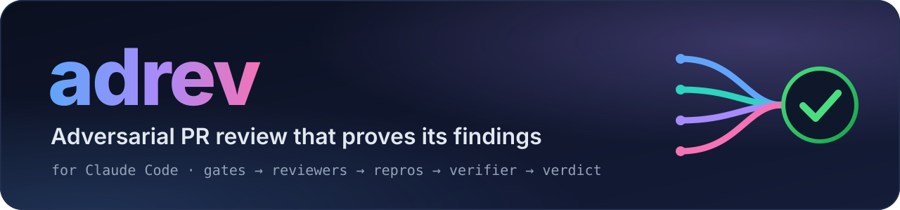

<p align="center">
  
</p>

<p align="center">
  
  
  
  
  
</p>

**A strict reviewer for your branch that has to prove what it claims.** `adrev` adds
`/adversarial-pr-review` to Claude Code: it runs your repo's own checks, sends read-only reviewers
to break the change, replays their repros in isolation, has a fresh model try to refute each
finding, and computes the verdict from rules instead of letting a model vote.

## Quick start

In Claude Code:

```text
/plugin marketplace add baoleka/adversarial-pr-review
/plugin install adrev@baoleka
```

Then, on the branch you want reviewed:

```text
/adversarial-pr-review --no-fix refactor: split the parser; behavior must not change
```

- **Intent:** a sentence or two on what the change should do. Leave it out and it's drafted from
  your commit messages.
- **`--no-fix`:** report only.
- **`--base-ref <ref>`:** the branch to compare against. The default is `origin/HEAD`, then
  `origin/main`, then `origin/master`.

> [!TIP]
> Drop `--no-fix` to run the fix loop: Claude fixes the findings, each fix is re-checked, and the
> run ends with APPROVE or ESCALATE. It never commits or pushes.

## How it works

<p align="center">
  
</p>

1. **Snapshot.** Your branch, uncommitted and untracked work included, is frozen as a commit and
   compared with its merge-base.
2. **Gates.** Your repo's own checks run at the base and at the head. Only the problems the change
   introduces count.
3. **Review lanes.** Read-only Claude sessions, up to four at a time, try to break the change and
   back their findings with repros. A probe session first checks that their write guard holds.
4. **Replay.** Each repro runs at the head and at the base, in a Docker container with no network,
   which tells introduced bugs from old ones.
5. **Verify.** A fresh model that sees only the claim tries to refute the findings, every critical
   and major one included.
6. **Verdict.** Rules, not a model, decide between APPROVE, REQUEST_CHANGES and ESCALATE.
7. **Fix loop.** Unless you pass `--no-fix`, Claude fixes or disputes the findings. Each fix is
   re-checked and each dispute is judged, for at most three rounds.

## The verdict

-  Nothing blocks or must
  still be addressed, every fix is verified, enough review lanes succeeded, and they covered the
  whole change.
-  A finding
  blocks or must be addressed. In the fix loop, Claude gets another round instead.
-  It can't conclude
  safely: a check or a lane failed, the budget or the round limit ran out, or a dispute stayed open.
  It says what needs your decision.

Problems that were already there before the change are reported as pre-existing and never block.
The full report is written to `.reviews/<run>/report.md`, which is kept out of git.

## Configure your repository

Optional, but it's how the review runs your CI: commit a `review.config.json` at the repository
root. It's read from the merge-base, so a change can't weaken its own review. Without it, adrev
runs its review sessions and verification only.

<details>
<summary><b>Example <code>review.config.json</code></b></summary>

```json
{
  "schema_version": "1",
  "repo": {
    "base_ref": "origin/main",
    "remote": "origin",
    "gates": [
      {"name": "ruff", "argv": ["ruff", "check", "--no-fix", "."], "parser": "ruff", "timeout_s": 300},
      {"name": "pytest", "argv": ["pytest", "-q"], "parser": "pytest", "timeout_s": 900}
    ],
    "changelogs": [{"path": "CHANGELOG.md", "globs": ["src/**"], "skip_marker": "changelog: skip"}],
    "conventions_docs": [{"path": "CONTRIBUTING.md"}],
    "file_classes": {"tests": ["tests/**"], "docs": ["docs/**", "*.md"]},
    "sensitive_paths": ["src/auth/**"],
    "security_patterns": ["subprocess", "shell=True", "pickle"]
  }
}
```

The full schema, with gates that use an error-count baseline, coverage, lane models, budgets and
known pre-existing problems, is in
[`skills/adversarial-pr-review/schemas/config.schema.json`](skills/adversarial-pr-review/schemas/config.schema.json).

</details>

## Requirements

| Needs | Details |
|---|---|
| **Claude Code** | 2.1.295 or later, logged in. The review sessions use the same login. |
| **Python and git** | Python 3.10 or later as `python3` (3.12 recommended), standard library only. git 2.31 or later. |
| **System** | Linux or macOS. Repros run only on Linux. |
| **Docker** *(optional)* | With a running daemon, repros run in containers. Without it, findings rest on traced code evidence instead of executed tests. |
| **Models** | By default Opus 5.5, Sonnet 5.5, Haiku 5.5 (the probe) and Fable 5.1 (rare adjudications). Override them per repo in `review.config.json`. |

> [!NOTE]
> To check a machine, ask Claude to *"check the adversarial-pr-review setup"*. It runs
> `review.py doctor`, which tests Python, git, Docker, the `claude` CLI and its login, runs one
> tiny confined probe session, and prints a fix for anything that fails. `doctor --models` also
> checks that your plan can use each model.

## Where it runs

| Where | How to get it |
|---|---|
| **Terminal** | `/plugin install adrev@baoleka`, as in the quick start. |
| **claude.ai/code** | On claude.ai, open Customize → Plugins → Add marketplace, enter `baoleka/adversarial-pr-review`, and install `adrev` with "Sync automatically" on. It also syncs to the terminals you sign in to. |
| **Routines** | Routines don't load plugins from claude.ai. Download `adversarial-pr-review-2.0.4.zip` from the [releases](https://github.com/baoleka/adversarial-pr-review/releases) and upload it under Customize → Skills. |

<details>
<summary><b>Notes for cloud sessions</b></summary>

Each cloud session is a fresh Linux VM. Reviews run end to end there: tested with Claude Code
2.1.303, the review sessions start and authenticate inside the VM.

- **History.** The review needs the merge-base with the base branch. If your clone is shallow, it
  stops and gives the `git fetch` command to run.
- **Gates.** The cloud image installs pytest as a standalone tool, so `python3 -m pytest` fails
  there. List `pytest` in `review.config.json`, or install pytest for `python3` in your
  environment's setup script.
- **Repros.** They're off by default, because the Docker daemon isn't running and Python is the
  system interpreter. Reviews still run, with findings resting on cited code instead of executed
  tests.
- **Unattended runs.** In a scheduled routine, a question from the driver ends the run as
  ESCALATE.
- **Both installed.** Where the plugin and the uploaded skill are both present, the upload shows
  up as `/anthropic-skills:adversarial-pr-review`, and `/adversarial-pr-review` stays the plugin's.

</details>

## Data and privacy

- **Model calls.** Review sessions are separate headless `claude -p` processes started on your
  machine (or in your cloud session) with your Claude Code login. They read the diff and the code
  at the base and head commits, and their requests go to Anthropic, like any Claude Code session.
  Up to 4 run at once, under a per-run budget cap.
- **Your checks.** adrev runs the commands listed in your `review.config.json`, on your machine,
  at the base and the head of the change.
- **Containers.** Repros run with no network, a read-only tree and no capabilities. If Docker works
  but the pinned `ubuntu:24.04` image is missing, it's pulled from Docker Hub.
- **Local writes only.** adrev never commits, pushes, comments or changes remote state.
- **No telemetry.** Besides the model calls and the optional image pull, nothing is sent anywhere.

<details>
<summary><b>Everything it does on your machine</b></summary>

- **Review sessions** run in restricted mode with an allowlist and a deny-by-default hook. They can
  write only in their own scratch folder. The budget cap is $15 for a report and $30 for the fix
  loop, at list prices.
- **Local writes:** `.reviews/` (listed in `.git/info/exclude`), refs under `refs/reviews/`,
  temporary worktrees removed after the verdict, and, in the fix loop, the fixes in your working
  tree.
- **Permissions.** The skill pre-approves its own driver command for the turn that invokes it.
  While it's active, a hook stops anything but the driver from writing to `.reviews/`.
  - The claude.ai skill upload can't carry that hook. Its review sessions keep their own guards,
    but nothing stops the session that runs it from editing the review's state files.
  - The driver hashes those files and ends in ESCALATE when one changes, unless the edit also
    rewrites the recorded hash.
- **Optional second model family (off by default).** If you enable it, it sends an export of the
  change to OpenAI's Codex, and it refuses to run unless file reads can be confined to that export.

</details>

## Cost

A report on a small change typically costs $1–2 of model usage, and the fix loop about twice
that. Very large diffs cost more, and are capped by the budget.

## How well it works

adrev v2 was benchmarked against an earlier single-reviewer version of the same skill (v1), on a
stand-in repository (pallets/click 8.1.8) with planted bugs, re-introduced real upstream bugs,
clean upstream commits, correct-but-unusual decoys, pre-existing problems, a prompt-injection item
and large changes. On a fresh held-out set of 24 items:

| | v1 | v2 |
|---|---|---|
| Bugs found | 100% | **100%** |
| False alarms on clean or decoy changes | 86% | **19%** |
| Fix loop ends in a correct approval | 79% | **100%** |
| Approvals of still-broken code | 0% | **0%** |
| Median cost per review | 1× | 1.2× |

On the first held-out set (26 items), v2 had 0% false alarms against 56%, 94% loop success against
69%, and 0% wrong approvals against 19%. The samples are small, so read these as directions rather
than precise rates.

## Limitations

- It needs Claude Code with Bash in a git repository; it doesn't run in claude.ai chat or Cowork.
- Routines need the claude.ai skill upload, which has no guard hook.
- Repros need Linux and a non-system Python. Paths with spaces aren't supported.
- With `permissions.blockReadsOutsideWorkingDirectories` on, add the plugin's folder
  (`~/.claude/plugins/cache/baoleka/adrev`) to `permissions.additionalDirectories`.
- Gates and checks know Python tooling best (ruff, mypy, pytest, coverage); other tools work
  through the `regex` and `exit` parsers.

## License

Apache-2.0. See [`LICENSE`](LICENSE) and [`NOTICE`](NOTICE).
